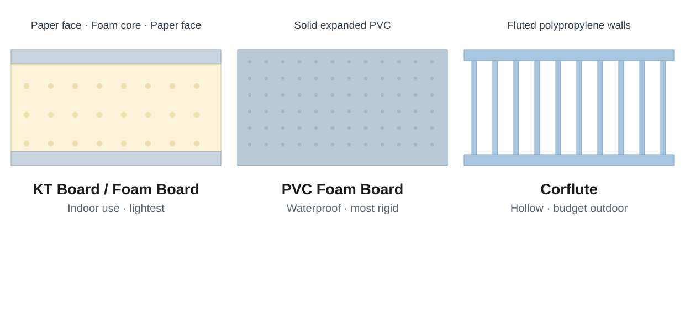

Three names cause regular confusion in board orders: KT board, foam board and PVC foam board. The first two usually describe the same material. The third is a different product altogether, and ordering one when you need the other is an expensive mistake. This guide separates them by structure, so you can specify the material itself instead of relying on a name.

## 1. Why the names get mixed up

"KT board" is the everyday trade name used in China and across much of Asia for a foam core board with paper faces. In Australia, the UK and North America, the same construction is sold as "foam board" or "foam core board". If you ask a Chinese supplier for foam board, this paper-faced foam core board is what you will be quoted.

"PVC foam board" is different. It is an expanded PVC plastic sheet with no paper anywhere in it — the material sold under brand names such as Foamex, Forex and Sintra. Because the two products share the word "foam", they are often treated as interchangeable in enquiries. They are not: they differ in water resistance, rigidity, service life and price.

## 2. KT board / foam board: paper-faced foam core

A KT board is a lightweight polystyrene foam core sandwiched between two paper faces, usually a coated printing paper. The paper faces give a smooth, flat surface for mounting printed graphics or for direct flatbed printing, and the foam core keeps the sheet rigid for its weight and easy to cut with a knife.

Typical characteristics:

- Very light and economical — the lowest-cost rigid board in this comparison
- Smooth paper surface, well suited to mounted posters and presentation graphics
- Not waterproof: the paper faces absorb moisture, swell and can warp in humid or wet conditions
- Edges dent and crush under impact, so it suits careful indoor handling
- Commonly supplied in thicknesses around 3–10 mm, with 5 mm the most common for display work; a common sheet size is 1220 × 2440 mm

Best for: indoor posters and research or conference presentation boards, retail point-of-sale displays, photo mounting, exhibition panels in dry indoor venues, and short-life promotional boards where low weight and low cost matter more than durability.

[View KT board specifications](./products/ys-kt-board/)

## 3. PVC foam board: solid expanded PVC sheet

PVC foam board is a single solid sheet of expanded (foamed) PVC plastic with a fine, even cell structure and a smooth matte or satin surface on both sides. There is no paper face and no separate core.

Typical characteristics:

- Waterproof through the whole sheet — it does not swell, rot or delaminate in wet conditions
- Noticeably stiffer and more impact-resistant than paper-faced foam board at the same thickness
- Can be routed, drilled, screwed and cut into letters or shapes while keeping a clean edge
- Heavier and more expensive than KT board
- Commonly supplied in thicknesses from about 1–10 mm, with 3 mm and 5 mm widely used for signage

Best for: rigid indoor and outdoor signs, cut-out letters and logos, panels that will be fixed with screws, and any board expected to survive handling, transport or weather. Confirm the expected outdoor service life and UV exposure with the supplier for long-term installations.

## 4. The board Australian buyers also ask about: corflute

If you buy signage in Australia, you will also meet corflute — corrugated (twin-wall) polypropylene sheet. It is a third, different material: hollow fluted plastic, very cheap, waterproof and widely used for real-estate and short-term outdoor signs. It is less rigid and less smooth than both boards above, so print finish and panel flatness are not comparable. Do not let a quotation substitute corflute for foam board or PVC foam board without agreeing the change — the price difference usually reflects a material difference.

## 5. At a glance

- Structure — KT/foam board: foam core with paper faces. PVC foam board: solid expanded PVC. Corflute: hollow fluted polypropylene.
- Water resistance — KT/foam board: indoor only. PVC foam board: waterproof. Corflute: waterproof.
- Rigidity and durability — KT/foam board: light duty, dents easily. PVC foam board: the most rigid and durable of the three. Corflute: flexible, can crease.
- Surface for print — KT/foam board: smooth paper, best for mounting and presentation graphics. PVC foam board: smooth plastic, direct-print friendly. Corflute: fluted texture can show through print.
- Relative cost — KT/foam board: lowest. Corflute: low. PVC foam board: highest of the three.

## 6. Which one should you order?

Choose KT board / foam board when the board stays indoors, weight and budget matter, and the job is posters, presentations or retail display. Choose PVC foam board when the panel must resist moisture, fixings or repeated handling, or carry cut shapes and letters. Choose corflute only when the priority is the lowest price for short-term outdoor signage and a less refined finish is acceptable.

Whatever the job, specify the material by its structure — "paper-faced foam core board" or "expanded PVC sheet" — rather than by a regional name, and confirm thickness, sheet size, print method (direct print or mounted graphic), lamination or edge finishing, and whether the board will be used indoors or outdoors before the quotation is prepared. If the application is exposed or long-term, describe the conditions in your enquiry so the material can be checked against the actual use.

For a wider comparison across roll media as well, see the [large format print media selection guide](./articles/large-format-print-media-selection-guide/).
