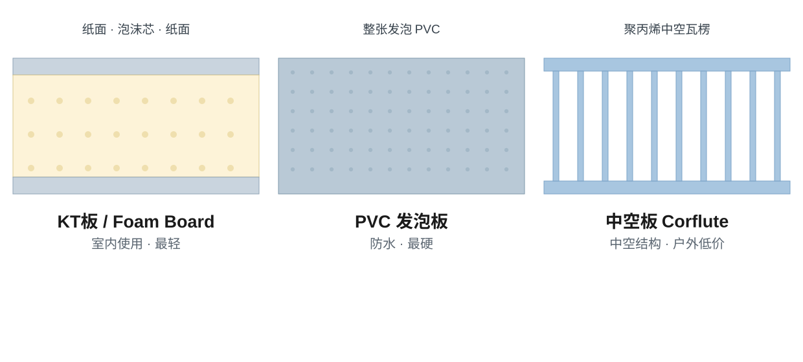

KT板、foam board、PVC发泡板，这三个名字在询价时经常被混用。前两个通常是同一种材料，第三个则是完全不同的产品，买错一次的代价不小。本文按材料结构把三者分清，询价时直接说结构，不靠名字猜。

## 1. 名字为什么会混

“KT板”是中国和亚洲贸易中的常用叫法，指纸面泡沫芯板。在澳洲、英国和北美，同样的结构叫 foam board 或 foam core board。向中国供应方询 foam board，报回来的就是这种纸面泡沫芯板。

“PVC发泡板”则不同，它是整张发泡PVC塑料板，里面没有任何纸面，类似 Foamex、Forex、Sintra 这类产品。两者都带“foam”，常被当作一回事，其实在防水性、硬度、使用寿命和价格上都不同。

## 2. KT板 / foam board：纸面泡沫芯板

KT板是聚苯乙烯泡沫芯夹在两层纸面之间的复合板，纸面通常为涂布印刷纸。纸面平整光滑，适合裱贴画面或平板直印；泡沫芯让整板又轻又挺，刀切方便。

典型特点：

- 非常轻、价格低，是本对比中最便宜的硬质板材
- 纸面光滑，适合裱贴海报和展示画面
- 不防水：纸面吸潮会膨胀，潮湿环境下可能变形
- 边角受撞击易凹陷，适合室内小心搬运的场景
- 常见厚度约3–10mm，展示用途以5mm最常见；常见板面尺寸为1220×2440mm

适合：室内海报、会议展示板、零售陈列、照片裱板、干燥室内展会展板，以及看重轻量和低成本的短期促销板。

[查看KT板规格](./products/ys-kt-board/)

## 3. PVC发泡板：整张发泡PVC板

PVC发泡板是整张发泡PVC塑料板，泡孔细密均匀，双面平整呈哑面或绸面效果，没有纸面，也没有夹芯结构。

典型特点：

- 整板防水，不吸水、不膨胀、不分层
- 同厚度下比纸面泡沫芯板明显更硬、更耐冲击
- 可铣型、钻孔、上螺丝，切割字形边缘干净
- 比KT板重，价格也更高
- 常见厚度约1–10mm，标识用途以3mm、5mm居多

适合：室内外硬质标识、切割字和logo、需要螺丝固定的展板，以及需要经受搬运或天气的板材。长期户外使用前，建议向供应方确认预期寿命和紫外线暴露情况。

## 4. 澳洲买家还会问到的：corflute（中空板）

在澳洲做标识还会遇到 corflute，即双壁中空聚丙烯板。这是第三种不同材料：中间镂空、价格低、防水，常用于房产广告牌和短期户外标识。它比上面两种板都软、表面平整度和印刷效果也不可同日而语。报价时若供应方用中空板替代泡沫板或PVC发泡板，务必先确认——价差通常正来自材料差异。

## 5. 快速对比

- 结构 — KT板/foam board：泡沫芯+纸面；PVC发泡板：整张发泡PVC；corflute：中空瓦楞聚丙烯
- 防水性 — KT板/foam board：仅限室内；PVC发泡板：防水；corflute：防水
- 硬度与耐久 — KT板/foam board：轻载、易凹陷；PVC发泡板：三者中最硬最耐用；corflute：偏软、可折痕
- 印刷表面 — KT板/foam board：纸面光滑，适合裱贴和展示；PVC发泡板：塑料光面，适合直印；corflute：瓦楞纹可能透印
- 相对成本 — KT板/foam board：最低；corflute：低；PVC发泡板：三者中最高

## 6. 到底该订哪种？

板子只在室内用、看重轻量和预算、工作是海报/展示/零售陈列，选KT板（foam board）；板子要防潮、要上固定件、要反复搬运或切割造型，选PVC发泡板；只有预算优先、短期户外、可以接受粗糙一些的效果时，才选corflute。

询价时建议按结构描述材料——“纸面泡沫芯板”或“发泡PVC整板”——不要只报地区叫法；并提前确认厚度、板面尺寸、印刷方式（直印还是裱贴）、是否覆膜或封边、使用环境是室内还是户外。若用于长期或暴露环境，请在询价时说明实际条件，以便先核对材料是否适用。

卷材类的对比可参阅[大幅面喷绘材料选型指南](./articles/large-format-print-media-selection-guide/)。
